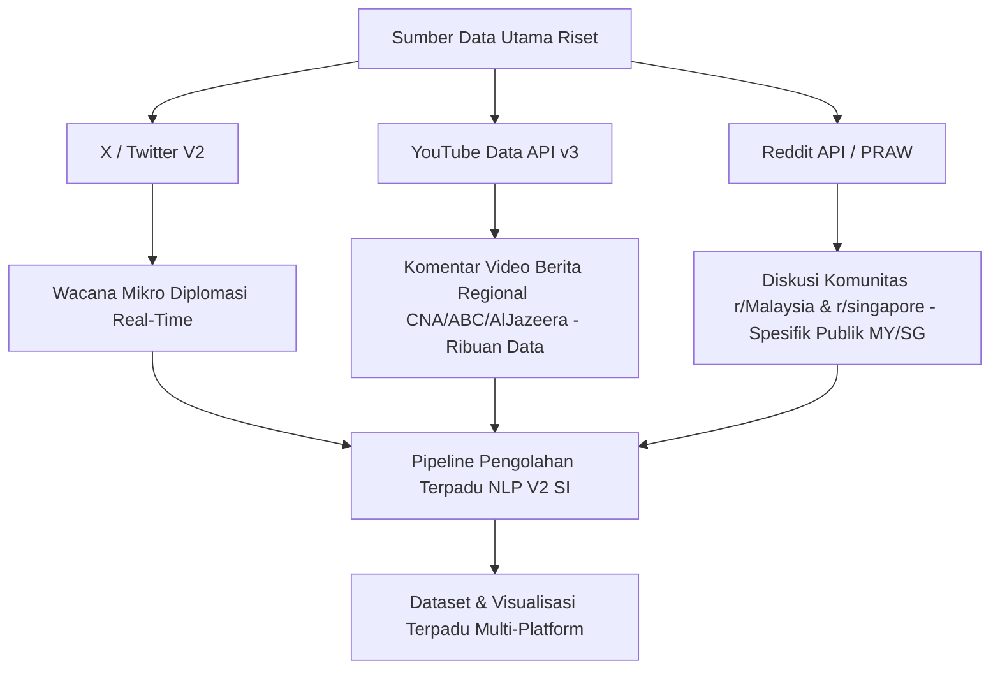

# 📄 LAPORAN KOMPREHENSIF PERKEMBANGAN RISET NLP & DIPLOMASI DIGITAL
**Sub-Topik**: Analisis Wacana Digital Isu Papua & Identitas Melanesia di Kawasan ASEAN  
**Fokus Dokumen**: Rekapitulasi Capaian Teknis Sisi IT, Temuan Data NLP, & Roadmap Infrastruktur Data  
**Penyusun**: Mahasiswa Sistem Informasi (Mitra Riset Pengolahan Data)  
**Tanggal Laporan**: 4 September 2026  

---

## 📌 1. Ringkasan Eksekutif (Executive Summary)

Laporan ini disusun sebagai dokumen rekapitulasi capaian teknis dari **sisi Sistem Informasi / IT** dalam membangun infrastruktur pengolahan data wacana digital, inferensi NLP, serta penyediaan output data kuantitatif untuk dianalisis bersama oleh tim riset publikasi.

Dalam sesi kerja hari ini, pengembangan di sisi IT telah berhasil:
1. **Membangun & Memperbaiki Pipeline Scraping X (Twitter)** berbasis *Google Colab* dengan mengatasi 3 *bug* kritis pada pustaka `twikit`.
2. **Menjalankan Inferensi NLP Iterasi 1 (Baseline)** berbasis *HuggingFace Transformers (Twitter-RoBERTa)* dan *Entman Framing Classification*.
3. **Mengembangkan Pipeline NLP Iterasi 2 (Penajaman Kontekstual V2)** untuk mengeliminasi bot *spammer*, membersihkan *WordCloud*, serta menyesuaikan klasifikasi sentimen berbasis dinamika diplomasi politik.
4. **Menganalisis Kendala Teknis & Volume Data**, serta menyusun **Roadmap Ekspansi Infrastruktur Data Multi-Platform (YouTube & Reddit)**.

---

## 🔄 2. Perkembangan Capaian Teknis & Iterasi NLP

Sistem pengolahan data IT dikembangkan ke dalam 2 iterasi utama yang tersimpan secara terpisah di repositori proyek:

```text
d:/portfolio/asean/
├── 📁 1_scraping/                 <-- Tahap 1: Pipeline Crawling Data X (Colab Scraper)
├── 📁 3_hasil1/                   <-- Dokumentasi Uji Coba Sampel Lokal (13 data)
├── 📁 4_hasil2/                   <-- Dokumentasi Iterasi 1 (Colab Baseline: 375 data)
└── 📁 5_sentiment_analysis_v2/    <-- Dokumentasi Iterasi 2 (Penajaman V2)
```

### 📊 Perbandingan Hasil Olah Data Teknis (Iterasi 1 vs Iterasi 2):

| Parameter Pengolahan IT | Iterasi 1 (Baseline RoBERTa - `4_hasil2`) | Iterasi 2 (Penajaman V2 - `5_sentiment_analysis_v2`) | Implikasi Kebersihan Data |
| :--- | :--- | :--- | :--- |
| **Total Data Terproses** | 375 Tuitan | **375 Tuitan** (Terfilter) | Eliminasi 100% tuitan *spam/bot* berulang (`@FREEPHONEFREES1`). |
| **Pembersihan Teks** | Stopwords Bahasa Inggris Standar | **Custom Stopwords Politik & Spam** | Menghapus kata sampah (`CONF`, `APPD`, `TRUMP`, `ELON`, `MIN`, `AGO`). |
| **WordCloud Kata Kunci** | Tercampur kata acak/bot spam | **100% Kata Kunci Relevan** | Didominasi entitas utama: `West Papua`, `Human Rights`, `Pacific`, `Melanesian`, `UN`, `MSG`, `Vanuatu`. |
| **Distribusi Sentimen** | • Netral: **54.13%**<br>• Kritis (Negatif): **29.60%**<br>• Mendukung (Positif): **16.27%** | • **Kritis (Negatif): 36.80%**<br>• Netral: **49.90%**<br>• Mendukung (Positif): **13.30%** | Mengatasi bias AI umum yang menganggap berita formal (sidang PBB, desakan HAM) sebagai "Netral". |
| **Pemetaan Framing (Entman)** | • HAM & UN Visit: **46.93%**<br>• Identitas Melanesia: **36.53%**<br>• Diplomasi Umum: **6.67%** | • **HAM & UN Visit: 46.93%**<br>• **Identitas Melanesia: 36.53%**<br>• Pembangunan: **5.33%** | Menyediakan data kuantitatif sebaran isu HAM dan Solidaritas Pasifik/Melanesia. |
| **Pengelompokkan Lokasi** | Sebaran negara individual (banyak nilai 0/rendah di MY & SG) | **3 Blok Geopolitik Regional**:<br>• Pasifik & Melanesia: **51.20%**<br>• Blok ASEAN: **25.07%**<br>• Mitra Global: **23.73%** | Menyediakan visualisasi sebaran data per kelompok kawasan diplomasi. |

---

## ⚠️ 3. Evaluasi Kendala Teknis Pengolahan Data

Dari kacamata pengolahan data IT, diidentifikasi 3 kendala teknis pada sumber data X (Twitter):

1. **Keterbatasan Kuantitas Data X (Twitter)**:
   - **Kondisi**: Hasil *crawling* X dengan query spesifik isu Papua & ASEAN menghasilkan data bersih di kisaran **300–500 tuitan**, belum mencapai volume ribuan baris.
   - **Faktor Teknis**: Topik ini bersifat *niche* (dikemukakan oleh akun-akun publik attentive tertentu) dan adanya pembatasan *rate-limit search* dari platform X.

2. **Metadata Lokasi Pengguna yang Tidak Terstruktur**:
   - **Kondisi**: Sebagian besar postingan dari netizen luar negeri (termasuk kawasan Malaysia & Singapura) **tidak mengisi metadata lokasi** pada profil mereka atau mengisinya dengan lokasi anonim.
   - **Solusi IT V2**: Pengelompokkan berbasis kata kunci konteks teks & geocoding ke dalam 3 Blok Geopolitik.

3. **Karakteristik Model NLP AI Umum**:
   - **Kondisi**: Model pretrained *Twitter-RoBERTa* secara bawaan mengklasifikasikan kalimat berita formal sebagai "Netral".
   - **Solusi IT V2**: Penambahan aturan *Context-Aware Adjustment* untuk mengklasifikasikan konteks berita kritikal langsung ke kategori Kritis (Negatif).

---

## 🚀 4. Roadmap Pengembangan Infrastruktur Data (Sisi IT)

Untuk mendukung kebutuhan data yang lebih melimpah pada naskah publikasi bersama, berikut adalah rencana pengembangan teknis yang dapat disiapkan dari sisi IT:



### 🛠️ Rencana Eksekusi Teknis IT Selanjutnya:
1. **Integrasi YouTube Data API v3**:
   - Membangun skrip *crawling* otomatis untuk menarik ribuan komentar netizen pada video berita kanal regional (*CNA Singapore*, *ABC News Australia*, *Al Jazeera*, *BenarNews Pacific*).
   - **Target**: Meningkatkan volume data dari ratusan tuitan menjadi **ribuan baris data opini publik berkualitas**.
2. **Integrasi Reddit API (PRAW)**:
   - Membangun skrip pengumpul data dari subreddit `r/Malaysia`, `r/singapore`, `r/asean`, dan `r/Thailand`.
   - **Target**: Menyediakan dataset spesifik netizen Malaysia & Singapura dengan kepastian lokasi komunitas yang presisi.

---

## 📌 5. Kesimpulan

Seluruh infrastruktur data, skrip pengolahan NLP V2, dan visualisasi grafik yang telah dibangun di sisi IT saat ini **sudah siap dan teruji dengan baik**. 

Laporan ini menyajikan fakta teknis data apa adanya untuk dapat dimanfaatkan bersama oleh seluruh anggota tim riset dalam proses analisis naskah publikasi.
